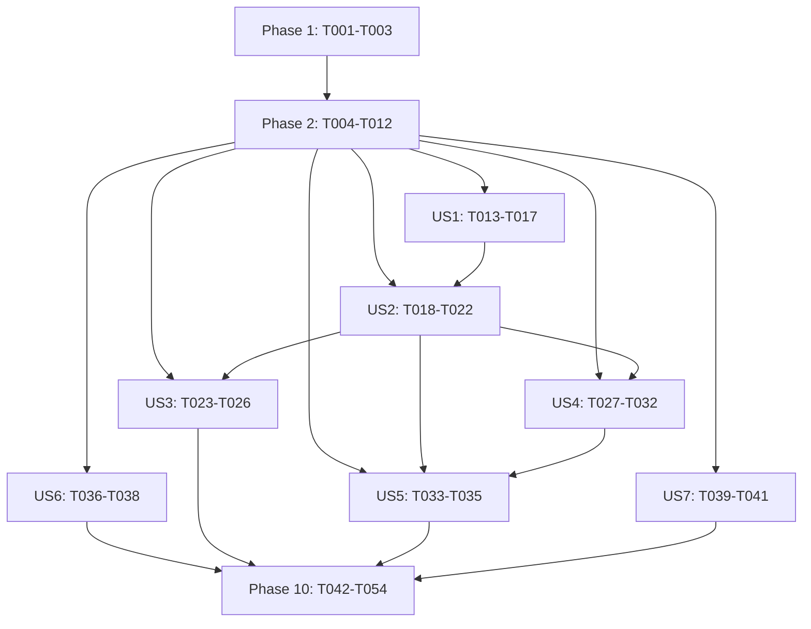

# Tasks: Chat flotante con Agente Analista de Requerimientos

**Feature**: `002-chat-agente-analista`  
**Rama de trabajo**: `feat/chat-agente-analista`  
**Fuentes normativas**: `spec.md`, `plan.md`, `research.md`, `data-model.md`, `quickstart.md`, `contracts/rest-api.yaml`, `contracts/mcp-tools.yaml`, `contracts/opencode-v2.md` y Constitución v1.0.0.  
**Estado**: verificadas 41 de 54 tareas. El 2026-10-27 se aprobaron 79 pruebas backend, 89 frontend, build Vite (1.768 módulos), validador documental y `git diff --check`. Esta ejecución no hizo llamadas de generación ni usó Ollama. T001 tuvo preflight estructural parcial satisfactorio sin generación y permanece pendiente; los nueve modelos `opencode` con costo publicado cero ya probados siguen sin respuesta (ocho 429 y uno no disponible), y no se volvieron a probar. T036 y T042–T045 y T047–T053 siguen sin marcarse: aceptación integrada, pruebas adversariales del modelo, estabilidad y PEAS dependen de generación real o de T042; T051 requiere además cinco usuarios. T052 se actualizó con comandos verificados, pero no se cierra antes de sus dependencias T042/T043. No se probaron modelos de pago; la generación histórica con Ollama no cuenta para la arquitectura actual.
**Total**: 54 tareas (T001-T054).
**Renumeración**: al insertar la compuerta técnica como T002, las tareas previas desde T002 avanzan un número (por ejemplo, T030→T031, T036→T037, T041→T042, T044→T045 y T046→T047); las dependencias se expresan con los IDs actuales.

## Convenciones

- `[P]` identifica una tarea que puede trabajarse en paralelo con otras tareas de su fase una vez satisfechas sus dependencias.
- `[US1]`–`[US7]` agrupan tareas por historia de usuario; las tareas sin etiqueta son de preparación, fundación o cierre.
- `Depende de` indica prerrequisitos concretos. Las dependencias compartidas se detallan también en **Dependencias críticas**.
- T001 separa verificación estructural de generación: el historial estructural no autoriza asumir que un modelo `opencode` genera. La cuota 429 bloquea solo generación real y tareas que la requieran. T002 valida LangChain, MCP y Langfuse de forma independiente y no espera a una generación; un fallo bloquea solo su código consumidor.

## Clasificación de las tareas pendientes (2026-10-27)

- **T001 — parcialmente independiente:** preflight estructural ejecutado sin prompt de generación; versión, Basic Auth, API v2, agente temporal, deny-all, creación de sesión y eliminación pasaron. Permanece pendiente porque no se acreditó una respuesta del proveedor `opencode`; no se verificó interrupción de una generación en esta ejecución.
- **T036 — requiere generación real:** los criterios miden conducta del modelo ante inyección, solicitudes fuera de rol, datos personales/incompletos y herramientas no autorizadas. Los tests con salida simulada no satisfacen T036.
- **T042 — requiere generación real:** integración manual completa hasta una respuesta React real.
- **T043 — trabajo automatizable parcialmente:** sus fallos inducidos pueden ejercitarse con dobles sin generación; la aceptación integrada final depende de T042 según esta tarea y permanece abierta.
- **T044 — trabajo automatizable parcialmente:** regresión, storage, scroll, estilos y responsive CSS pueden comprobarse sin generación. Sus mediciones de respuesta real y el cierre de aceptación dependen de T042; no se infiere rendimiento visual desde jsdom.
- **T045 — bloqueada por dependencia T042:** la serie de estabilidad completa debe ejecutarse con el flujo integrado y sus criterios/denominadores medidos; no se marca con pruebas unitarias aisladas.
- **T047–T050 — requieren generación real y evaluación:** necesitan respuestas del modelo, corpus histórico anonimizado y evaluadores; T048 además requiere N=10, T049 dos analistas y T050 una línea base manual comparable.
- **T051 — requiere T042 y cinco usuarios:** ninguna muestra de usuarios se ha ejecutado.
- **T052 — documentación independiente en contenido, bloqueada para cierre por dependencia:** comandos/versiones se verificaron y la guía se sincronizó con la implementación observada, pero T042/T043 siguen pendientes.
- **T053 — cierre dependiente:** requiere la aceptación/evaluaciones de T042–T052; no puede cerrarse con bloqueantes abiertos ni sin revisión evaluada.

## Phase 1: Setup (Preflights y compuertas de compatibilidad)

**Purpose**: Verificar en entornos aislados los contratos externos antes de configurar el agente definitivo o escribir código de aplicación dependiente.

- [ ] T001 Ejecutar preflight estructural contra el OpenCode ya activo, sin iniciar otro proceso: validar version, Basic Auth, rutas v2, agentes, proveedores/modelos, prompt, permisos deny-all, sesion e interrupt/delete. Separar esas comprobaciones de la generacion: solo cerrar la generacion cuando un modelo `opencode` seleccionado complete una respuesta y el ciclo de vida se valide sin consumir presupuesto no autorizado. Las generaciones historicas con otro proveedor no satisfacen este criterio. Registrar resultados sanitizados; no usar `/global/health` ni `/doc` como contratos API. Archivos: `contracts/opencode-v2.md`, `quickstart.md`, `scripts/diagnostics/opencode-v2-t001.mjs`. Depende de: ninguna.
- [x] T002 Comprobar las versiones candidatas y el contrato mínimo real de LangChain, MCP/FastMCP y Langfuse en un entorno desechable antes de escribir código de aplicación dependiente: importaciones/APIs de composición y parser de LangChain; arranque MCP stdio, listado de herramientas y validación de entradas/salidas; inicialización de Langfuse, masking con datos sintéticos y comportamiento sin credenciales o ante fallo. Registrar versiones exactas, comandos, resultados y límites en `research.md` y evidencia sin secretos. Si una API no existe, no se importa o no satisface masking/degradación, detener T006/T009/T011 y los consumidores posteriores; actualizar plan/contratos y dependencias antes de codificar. Depende de: T001 estructural; no depende de generaci?n.
- [x] T003 Crear la estructura `agentes/analista/{api,core,mcp,fuentes,prompts,opencode,tests}` y los archivos iniciales de configuración para Python 3.12, `requirements.txt`, `.env.example`, logging seguro y README; fijar solo dependencias aprobadas por T002 y generar el lockfile tras resolverlas. Escuchar solo en `127.0.0.1`; mantener credenciales fuera del repositorio y del navegador. Depende de: T002. Archivos: `agentes/analista/api/`, `agentes/analista/core/`, `agentes/analista/mcp/`, `agentes/analista/fuentes/`, `agentes/analista/prompts/`, `agentes/analista/opencode/`, `agentes/analista/tests/`, `agentes/analista/requirements.txt`, `agentes/analista/.env.example`, `agentes/analista/README.md`.

## Phase 2: Foundational (Base compartida del agente; bloquea las historias)

**Purpose**: Completar contratos, estado, MCP, OpenCode, LangChain, FastAPI y observabilidad antes de implementar historias.

- [x] T004 Definir modelos Pydantic v2 para solicitudes, respuestas, errores, health, conversación, turno, análisis, pregunta, ejecución de herramienta y registro PEAS, aplicando enums, límites, UUID, `additionalProperties: false`, readiness conservadora y ausencia de campos internos en respuestas públicas. Reglas del contrato: mensaje no vacío de hasta 4.000 puntos de código; contexto total máximo 24.000 caracteres; cada lista de análisis obligatoria, máximo 100 elementos y 1–1.000 caracteres por elemento; preguntas máximo 50, texto 1–500 caracteres, con categorías/estados enumerados; Markdown de respuesta 1–50.000 caracteres; máximo 4 fuentes, 10 limitaciones de 1–300 caracteres y duración no negativa medida. Campos extra prohibidos, UUID v4 e invariantes de readiness. Depende de: T003. Archivos: `agentes/analista/core/models.py`.
- [x] T005 Implementar `ConversationStore` en memoria con locks por conversación, generación, turnos activos, historial solo de turnos completados, idempotencia por `request_id` y hash de mensaje, límite global, máximo 32 conversaciones y TTL de 30 minutos con limpieza periódica. Depende de: T004. Archivos: `agentes/analista/core/conversation_store.py`.
- [x] T006 [P] Crear fixtures ficticios/anonimizados y el servidor FastMCP stdio con exactamente `consultar_glosario`, `buscar_hu_similares`, `consultar_estandares` y `aplicar_checklist_vacios`; validar esquemas, límites, orden determinista y `total`; rechazar herramientas de escritura, archivos, shell o red; no registrar consultas ni resultados. Archivos: `agentes/analista/mcp/server.py`, `agentes/analista/mcp/tools.py`, `agentes/analista/mcp/repositories.py`, `agentes/analista/fuentes/*.json`. Depende de: T002, T003.
- [x] T007 [P] Definir el agente `analista` con contrato OpenCode v2: `system` carga el prompt externo y conserva permisos deny-all; `opencode.jsonc` no fija modelo ni proveedor. El backend selecciona exclusivamente `providerID=opencode` mediante `OPENCODE_MODEL_ID` opcional o el default de OpenCode si pertenece a ese proveedor. Validar prompt/hash y configuracion del agente. La cuota se evalua en T001/T042 y no bloquea comprobaciones independientes. Archivos: `opencode.jsonc`, `agentes/analista/prompts/sistema.md`, `agentes/analista/core/prompt_loader.py`. Depende de: T001 estructural, T002 y T003.
- [x] T008 Implementar y probar el cliente interno `httpx` para OpenCode `2.0.27` y `2.1.2`/API v2: Basic Auth solo en backend, `GET /api/info`, agente y modelos; seleccionar solo `providerID=opencode` desde `OPENCODE_MODEL_ID` o default compatible y exigir costo cero publicado; crear sesion con `Model.Ref {id, providerID}` y deny-all; admitir `POST /prompt`, sondear `/message`, cancelar con `/interrupt` y borrar con `DELETE` en `finally`. Mapear 401/403, 404, 409, 429/`provider.quota`/`provider.free-limit`, 503, 504/deadline, modelo ausente, desconexion y schema incompatible. Normalizar `retryAfterMs` del error de sesion usando `time.completed`, propagarlo como `retry_at` y nunca registrar cuerpos, texto, sesion ni credenciales. Las pruebas unitarias aisladas no prueban generacion real. Archivos: `agentes/analista/core/opencode_client.py`, `agentes/analista/tests/unit/test_opencode_client.py`. Depende de: T004 y T007.
- [x] T009 Implementar el flujo efectivo de LangChain solo con las APIs aprobadas por T002: `ChatPromptTemplate` para contexto de usuario, fan-out `RunnableParallel` de las cuatro herramientas MCP con timeout individual de 5 s, adaptador MCP aislado, parser/salida tipada realmente importable, llamada real a OpenCode mediante `RunnableLambda`, una sola reparación dentro del deadline compartido de 90 s y normalización de preguntas, fuentes y readiness. Continuar ante fallos de herramientas individuales declarando limitaciones; no usar modelo falso ni `create_agent`. Archivos: `agentes/analista/core/context_builder.py`, `agentes/analista/core/output_parser.py`, `agentes/analista/core/orchestrator.py`. Depende de: T002, T004–T008.
- [x] T010 Exponer FastAPI según `contracts/rest-api.yaml`: health, crear conversación, enviar mensaje, cancelar, reiniciar y eliminar; validar entrada/campos/tamaños; usar sobres de error estables; derivar fuentes solo de ejecuciones MCP exitosas; limitar CORS y publicar únicamente por loopback. Archivos: `agentes/analista/api/main.py`, `agentes/analista/api/routes/health.py`, `agentes/analista/api/routes/conversations.py`, `agentes/analista/api/errors.py`. Depende de: T004, T005, T009.
- [x] T011 [P] Instrumentar Langfuse con la API aprobada por T002: correlación por conversación/solicitud/turno, duración real, herramientas y códigos de error; configurar y comprobar masking de inputs, outputs, prompts y contenido de fuentes; si está ausente o falla, degradar health/diagnóstico sin detener el chat ni esperar la exportación. No devolver claves ni `trace_id`. Archivos: `agentes/analista/core/observability.py`. Depende de: T002, T004, T009.
- [x] T012 Añadir pruebas automatizadas backend de modelos, REST, estados, errores, idempotencia, capacidades, contratos MCP y OpenCode, reparación, readiness, TTL, fuentes y privacidad; usar dobles solo en pruebas y `httpx.MockTransport` para casos unitarios. Mantener separada la prueba real de integración. Archivos: `agentes/analista/tests/unit/`, `agentes/analista/tests/contract/`, `agentes/analista/tests/integration/`. Depende de: T004–T011.

## Phase 3: User Story 1 — Chat disponible en toda la aplicación (Priority: P1)

**Goal**: Dar acceso global y conservar el chat al cerrar.

**Independent Test**: Recorrer las rutas, abrir/cerrar conservando historial y comprobar teclado y viewport de 360 px.

### Tests for User Story 1

- [x] T013 [P] [US1] Configurar Vitest, jsdom, React Testing Library y scripts de prueba en el stack JavaScript existente; añadir únicamente las dependencias de Markdown/pruebas previstas, sin TypeScript, framework UI ni gestor de estado prohibidos. Archivos: `vitest.config.js`, `src/test/setup.js`, `package.json`.
- [x] T014 [P] [US1] Añadir pruebas de regresión antes de implementar el chat: launcher y navegación en todas las rutas; render/acciones de Dashboard y listado; generación simulada, navegación y estado del Stepper; apertura/uso del Accordion; estilos y layout responsive 360/768/escritorio; y claves/datos preexistentes en `localStorage` (incluida `storycraft_user_stories`) antes y después de montar, usar y desmontar el chat. Probar FR-013 en tres casos medibles: a ≤80 px del final, un mensaje nuevo sigue al final; a >80 px, se conserva la posición y aparece «Ir al último mensaje»; al activarlo se llega al final y el control desaparece. Escribir o actualizar health sin agregar un mensaje no mueve el scroll. Las pruebas demostrarán que no se borran ni mutan datos existentes, no se crean claves de chat y no se sustituyen pantallas, estilos o flujos. Archivos: `src/components/AsistenteAnalista/__tests__/AsistenteAnalista.test.jsx`, `src/__tests__/legacy-regression.test.jsx`. Depende de: T013.
### Implementation for User Story 1

- [x] T015 [P] [US1] Crear `src/services/analystApi.js` para consumir `/api/analista` y configurar el proxy Vite hacia `127.0.0.1:8000`; el navegador no debe llamar OpenCode, MCP o Langfuse ni guardar identificadores o contenido en storage. Archivos: `src/services/analystApi.js`, `vite.config.js`. Depende de: T013.
- [x] T016 [US1] Implementar `useAsistenteAnalista.js` y los componentes `AsistenteAnalistaComponent`, launcher y panel; montar una sola instancia al final de `EnvolturaPaginaComponent`; mantener el panel montado al cerrar y conservar mensajes/estado sin alterar rutas existentes. Archivos: `src/hooks/useAsistenteAnalista.js`, `src/components/AsistenteAnalista/AsistenteAnalistaComponent.jsx`, `src/components/AsistenteAnalista/LanzadorAsistenteComponent.jsx`, `src/components/AsistenteAnalista/PanelAsistenteComponent.jsx`, `src/components/EnvolturaPagina/EnvolturaPaginaComponent.jsx`. Depende de: T013, T015.
- [x] T017 [P] [US1] Crear `_analyst-chat.scss` y la interacción accesible: escritorio/tableta/móvil desde 360 px sin overflow, launcher sin cubrir controles, foco al abrir y retorno al cerrar, Escape, labels, roles, `aria-live`, contraste y `prefers-reduced-motion`. Archivos: `src/styles/_analyst-chat.scss`. Depende de: T016.

## Phase 4: User Story 2 — Consulta real al Agente Analista (Priority: P1)

**Goal**: Enviar una solicitud al agente real y gestionar el estado/error del turno.

**Independent Test**: Con backend real, enviar una consulta y comprobar respuesta, doble envío único y recuperación si el servicio cae.

### Tests for User Story 2

- [x] T018 [P] [US2] Añadir primero pruebas automatizadas (y confirmar que fallan antes de la implementación) para envío, límite de entrada, solicitud única ante doble envío, 409, error recuperable y reintento idempotente; reservar la prueba manual real para T042 y usar dobles solo en pruebas. Archivos: `src/components/AsistenteAnalista/__tests__/AsistenteAnalista.test.jsx`. Depende de: T012, T013.
### Implementation for User Story 2

- [x] T019 [P] [US2] Implementar la consulta de health al montar y `AnalystHealthBadge` con estados comprobando/listo/degradado/no disponible; bloquear envío solo cuando no se puede garantizar la ejecución real y no anunciar “en línea” sin comprobar dependencias. Archivos: `src/components/AsistenteAnalista/PanelAsistenteComponent.jsx`, `src/hooks/useAsistenteAnalista.js`. Depende de: T010, T015.
- [x] T020 [US2] Implementar composer, contador/límite Unicode de 4.000 caracteres, validación vacía, Enter/doble clic, estado de procesamiento inmediato y una sola solicitud en vuelo; crear un `request_id` por intento y evitar duplicados en UI. Archivos: `src/components/AsistenteAnalista/PanelAsistenteComponent.jsx`, `src/hooks/useAsistenteAnalista.js`. Depende de: T016, T019.
- [x] T021 [US2] Conectar el envío al endpoint real y representar respuesta validada del agente; mantener el indicador hasta éxito/error/cancelación/reinicio y mostrar mensaje de usuario como texto plano. No usar respuestas simuladas, predefinidas ni locales. Archivos: `agentes/analista/core/orchestrator.py`, `src/services/analystApi.js`, `src/hooks/useAsistenteAnalista.js`. Depende de: T009, T010, T020.
- [x] T022 [US2] Mapear errores REST a mensajes y acciones en español: servicio/modelo, autenticación/configuración, validación, turno activo, salida inválida, sesión perdida, indisponibilidad y fallo de red; permitir reintento con la identidad apropiada y conservar el borrador. Archivos: `src/utils/analystErrors.js`, `src/components/AsistenteAnalista/AsistenteAnalistaComponent.jsx`. Depende de: T010, T020, T021.

## Phase 5: User Story 3 — Lectura segura y estructurada (Priority: P1)

**Goal**: Mostrar análisis estructurado y Markdown GFM seguro.

**Independent Test**: Renderizar estructura válida e inválida y cargas maliciosas sin JSON crudo ni HTML activo.

### Tests for User Story 3

- [x] T023 [P] [US3] Añadir primero pruebas de esquema inválido/incompleto y Markdown GFM válido; cubrir HTML anidado/crudo, script, atributos de evento, `javascript:`, `data:`, `blob:`, `file:`, URL ofuscada e imagen remota, verificando cero ejecución, HTML arbitrario o navegación peligrosa. Archivos: `src/__tests__/analystResponse.test.js`. Depende de: T013, T021.
### Implementation for User Story 3

- [x] T024 [P] [US3] Validar en el cliente el esquema completo de cada respuesta antes de renderizar: cuatro listas, preguntas/categorías/estados, fuentes, readiness, IDs públicos, duración y versión; ante invalidez mostrar error controlado y nunca JSON crudo ni contenido parcial. Archivos: `src/utils/analystResponse.js`. Depende de: T004, T010, T021.
- [x] T025 [US3] Implementar vistas de análisis, preguntas, fuentes y readiness; mostrar siempre las cuatro categorías incluso vacías, categoría/estado de cada pregunta, resultados reales por fuente, limitaciones, duración medida y texto “Listo para el Redactor-Revisor” sin sugerir aprobación. Archivos: `src/components/AsistenteAnalista/PanelAsistenteComponent.jsx`, `src/components/AsistenteAnalista/PanelAsistenteComponent.jsx`, `src/components/AsistenteAnalista/PanelAsistenteComponent.jsx`. Depende de: T024.
- [x] T026 [US3] Implementar `MarkdownAsistenteComponent` con `react-markdown` + `remark-gfm`, `skipHtml`, elementos permitidos explícitamente, sin `rehype-raw` ni imágenes remotas, task-list checkboxes deshabilitados y `urlTransform` limitado a `http`, `https` y anclas; usar `rel="noopener noreferrer"` en enlaces externos. Archivos: `src/components/AsistenteAnalista/MarkdownAsistenteComponent.jsx`. Depende de: T013, T024.

## Phase 6: User Story 4 — Reinicio/eliminación sin respuestas tardías (Priority: P1)

**Goal**: Cancelar, reiniciar o eliminar durante el procesamiento sin aceptar resultados tardíos.

**Independent Test**: Inducir respuesta lenta, cancelar/reiniciar/eliminar y verificar conservación/invalidez por identidad.

### Tests for User Story 4

- [x] T027 [P] [US4] Añadir primero pruebas de carreras de cancelar/commit, cancelar/respuesta, reiniciar/eliminar mientras procesa, timeout justo al commit, repetición, sesión perdida y respuesta tardía; comprobar que contexto viejo nunca se incorpora ni se muestra y que el chat se libera. Archivos: `agentes/analista/tests/unit/test_conversation_store.py`, `agentes/analista/tests/unit/test_turn_deadline.py`, `src/components/AsistenteAnalista/__tests__/AsistenteAnalista.test.jsx`, `src/hooks/__tests__/useAsistenteAnalista.test.jsx`. Depende de: T012, T013.
### Implementation for User Story 4

- [x] T028 [P] [US4] Implementar controles separados: cerrar conserva todo y no cancela; Nuevo chat limpia de inmediato, invalida/reemplaza la conversación y mantiene panel abierto; Eliminar pide confirmación, elimina en servicio y cierra; cancelar el diálogo conserva la conversación. Archivos: `src/components/AsistenteAnalista/DialogoEliminarConversacionComponent.jsx`, `src/hooks/useAsistenteAnalista.js`. Depende de: T016, T021.
- [x] T029 [P] [US4] Implementar cancelación backend idempotente: marcar/inutilizar el turno bajo lock antes del aborto OpenCode, liberar `active_turn`, preservar contexto previo e historial anterior y excluir turno cancelado; limpiar la sesión efímera. Archivos: `agentes/analista/api/routes/conversations.py`, `agentes/analista/core/conversation_store.py`, `agentes/analista/core/opencode_client.py`. Depende de: T005, T008, T010.
- [x] T030 [US4] Implementar deadline total configurable de 90 s para herramientas, OpenCode, parsing y reparación; al vencer marcar expirado, liberar conversación, solicitar aborto y borrar sesión, devolver 504 controlado y no hacer commit al contexto. Archivos: `agentes/analista/core/orchestrator.py`, `agentes/analista/core/opencode_client.py`, `agentes/analista/api/routes/health.py`, `agentes/analista/api/routes/conversations.py`, `agentes/analista/.env.example`. Depende de: T005, T008, T010.
- [x] T031 [US4] Implementar en React `requestEpoch`, `activeRequestId` y `AbortController`; invalidar época al cancelar/reiniciar/eliminar/recargar y aceptar respuestas solo si conversación, turno, solicitud y época aún son vigentes; el timeout visual debe activar cancelación y no dejar spinner indefinido. Archivos: `src/hooks/useAsistenteAnalista.js`, `src/services/analystApi.js`. Depende de: T021, T028–T030.
- [x] T032 [US4] Completar ciclo de vida de servidor: reinicio crea identidad nueva, eliminación idempotente devuelve 204, 404 ofrece nuevo chat, expiración TTL elimina turnos y aborta trabajo activo, máximo 32 conversaciones y ninguna identidad/conversación almacenada en navegador. Una recarga no recupera ni reenvía el ID anterior; el registro huérfano permanece solo en memoria del backend hasta eliminación, expiración por inactividad (TTL inicial de 30 min desde la última actividad), expulsión por capacidad o apagado/reinicio del proceso. Al alcanzar 32, expulsar el registro sin turno activo menos recientemente usado; si todos tienen uno activo, rechazar creación con `503 CAPACITY_EXCEEDED` y nunca expulsar un turno en curso. La recarga solicita cancelación del turno activo cuando el navegador aún puede comunicarla; la limpieza por TTL/reinicio sigue siendo el límite aunque el cierre de página impida ese aviso. Archivos: `agentes/analista/core/conversation_store.py`, `agentes/analista/api/routes/conversations.py`. Depende de: T005, T010, T029–T031.

## Phase 7: User Story 5 — Continuidad del análisis (Priority: P1)

**Goal**: Mantener contexto y actualizar análisis/preguntas con las respuestas de Negocio.

**Independent Test**: Resolver una pregunta en un turno posterior y comprobar clasificación/contexto actualizado.

### Tests for User Story 5

- [x] T033 [P] [US5] Añadir primero pruebas de conversación de varios turnos: seguimiento conserva contexto, respuesta de Negocio mueve confirmado a conocida y resuelve vacíos, pendiente permanece visible, pregunta respondida no se reabre sin contradicción y nuevo chat/recarga no hereda contexto. Archivos: `agentes/analista/tests/integration/test_context_continuity.py`. Depende de: T012, T013.
### Implementation for User Story 5

- [x] T034 [P] [US5] Construir contexto canónico desde el servidor: análisis/preguntas/readiness actuales, hasta seis turnos de usuario completados, resumen previo de máximo 2.000 caracteres, mensaje actual, resultados MCP no confiables y limitaciones; máximo 24.000 caracteres, recortando historia antigua antes que el mensaje actual. Archivos: `agentes/analista/core/context_builder.py`. Depende de: T005, T006, T009.
- [x] T035 [US5] Implementar consolidación de análisis y fusión de preguntas entre turnos: mantener IDs estables, estados respondidos e ítems pendientes omitidos, actualizar evidencia/turnos, deduplicar por texto normalizado y aplicar compuerta estricta de readiness. Archivos: `agentes/analista/core/orchestrator.py`, `agentes/analista/core/conversation_store.py`, `agentes/analista/core/models.py`. Depende de: T004, T005, T009, T034.

## Phase 8: User Story 6 — Rigor y límites del rol Analista (Priority: P1)

**Goal**: Mantener al agente dentro del rol y las cuatro fuentes de solo lectura.

**Independent Test**: Ejecutar casos de inyección, invención y solicitud de redactar/aprobar HU.

### Tests for User Story 6

- [ ] T036 [P] [US6] Añadir primero pruebas adversariales de inyección en mensajes y fuentes, solicitud de redactar/aprobar/priorizar HU, datos incompletos o personales, reglas similares y herramienta no autorizada; verificar cero invenciones como hechos, cero HU y advertencia sin repetir innecesariamente datos personales. Archivos: `agentes/analista/tests/integration/test_role_boundaries.py`. Depende de: T012.
### Implementation for User Story 6

- [x] T037 [P] [US6] Ajustar y validar `agentes/analista/prompts/sistema.md` como prompt externo cargado en runtime: rol semiautónomo, cuatro clasificaciones, preguntas, solicitudes de validación humana, no inventar/no convertir supuesto en hecho y prohibición de redactar, aprobar o priorizar HU; registrar versión/hash, confirmar que el agente v2 carga el archivo configurado, congelar la versión/hash de referencia y requerir reinicio del backend ante cambios del prompt local. Archivos: `agentes/analista/prompts/sistema.md`, `agentes/analista/core/prompt_loader.py`, `agentes/analista/tests/unit/test_prompt_loader.py`. Depende de: T007, T009.
- [x] T038 [P] [US6] Aplicar y verificar las defensas fuera del prompt: allowlist de cuatro herramientas en adaptador Python/MCP, permisos efectivos deny de OpenCode, fixtures no confiables delimitados y sin sistemas reales, archivos, shell, internet, correo o escritura. Archivos: `agentes/analista/core/orchestrator.py`, `agentes/analista/mcp/tools.py`. Depende de: T001, T006–T009.

## Phase 9: User Story 7 — Diagnóstico y degradación controlada (Priority: P2)

**Goal**: Dar diagnóstico correlacionado y degradar sin bloquear el chat.

**Independent Test**: Verificar traza enmascarada con Langfuse y chat funcional con Langfuse desactivado.

### Tests for User Story 7

- [x] T039 [P] [US7] Añadir primero pruebas de health en los tres estados, traza correlacionada, ausencia de prompt/texto/secreto/datos personales, fallo/desactivación de Langfuse con chat funcional y errores sin stack ni IDs internos en navegador. Archivos: `agentes/analista/tests/integration/test_observability.py`, `src/components/AsistenteAnalista/__tests__/AsistenteAnalista.test.jsx`. Depende de: T012, T013, T018.
### Implementation for User Story 7

- [x] T040 [P] [US7] Completar health real de backend con OpenCode/version/agente, configuración y prompt/hash, MCP/herramientas y Langfuse; health no crea sesión ni llama al modelo salvo la comprobación controlada definida, no filtra prompt/secreto y distingue ready/degraded/unavailable según el contrato. Archivos: `agentes/analista/core/health.py`, `agentes/analista/api/routes/health.py`. Depende de: T006–T011.
- [x] T041 [US7] Completar spans y correlación Langfuse para turno, herramientas y OpenCode con duraciones/códigos reales y masking; manejar claves ausentes, exportación fallida y apagado sin bloquear la respuesta; reflejar el aviso de diagnóstico limitado en la UI. Archivos: `agentes/analista/core/observability.py`, `src/components/AsistenteAnalista/PanelAsistenteComponent.jsx`. Depende de: T011, T019, T040.

## Phase 10: Polish & Cross-Cutting Concerns

**Purpose**: Ejecutar la integración y aceptación, medir resultados y sincronizar documentación.

- [ ] T042 Ejecutar prueba manual end-to-end controlada React → Vite proxy → FastAPI → LangChain → cuatro herramientas MCP → OpenCode `2.0.27` o `2.1.2`/API v2 y modelo seleccionado → respuesta React; confirmar `/api/info`, prompt T037, salud, fuentes ejecutadas, traza enmascarada y ausencia de llamadas del navegador a OpenCode/Langfuse. Adjuntar evidencia sin secretos; no usar `/doc` como schema local. Archivos: `specs/002-chat-agente-analista/evidence/`. Depende de: T022, T026, T032, T035, T037, T038, T041.
- [ ] T043 Ejecutar matriz integrada de errores inducidos (servicio/modelo caído, 401/403, versión/contrato incompatible, timeout, salida inválida, 404, 409, fallo MCP, red incierta y observabilidad caída); comprobar mensaje recuperable, identidad de reintento, contexto intacto y recuperación tras restablecer servicio. Archivos: `agentes/analista/tests/integration/`, `src/components/AsistenteAnalista/__tests__/`. Depende de: T022, T032, T041, T042.
- [ ] T044 Verificar criterios de aceptación SC-001–SC-004, SC-009, SC-013–SC-015 y SC-017 con resultados medidos y evidencia. La regresión debe recorrer Dashboard, listado, Stepper, Accordion, todas las rutas, estilos responsive y datos/claves previas de `localStorage`; separar esos resultados de la prueba de integración de T042. Confirmar también F-15/FR-013: seguimiento al final solo a ≤80 px, navegación previa sin saltos, control «Ir al último mensaje» y sin movimiento por cambios que no agregan mensajes. Registrar mediciones: 100 % de rutas con launcher en menos de 1 s y panel en menos de 0,5 s; primera consulta en 3 interacciones; 95 % con indicador en menos de 2 s y éxito/error explícito dentro de 90 s; 100 % de respuestas reales; estructura completa sin JSON crudo; regresión y build sin reemplazos; cero persistencia de chat/secreto y cero violaciones del rol. No inferir resultados del diseño. Archivos: `specs/002-chat-agente-analista/evidence/acceptance.md`. Depende de: T014, T017, T022, T026, T038, T042.
- [ ] T045 Ejecutar las series SC-007, SC-008, SC-018, SC-019 y SC-020: 20 reinicios lentos, 20 dobles envíos, 20 cancelaciones lentas, 20 recargas y 20 timeouts; guardar denominador, resultados, tiempos observados y fallos: SC-007 debe limpiar en menos de 5 s; SC-008 debe producir una solicitud/respuesta única en el 100 %; SC-018 debe detener en menos de 2 s y conservar historial/contexto previos; SC-019 debe iniciar vacío sin storage y dejar el registro anterior en memoria solo hasta su TTL/reinicio según T032; SC-020 debe liberar en menos de 2 s después del timeout. Registrar fallos sin presentar metas como medidas. Archivos: `specs/002-chat-agente-analista/evidence/stability-runs.md`. Depende de: T031, T032, T042.
- [x] T046 [P] Ejecutar SC-010 con al menos 10 cargas maliciosas distintas de Markdown/HTML y registrar evidencia de cero scripts, inserciones HTML arbitrarias y navegaciones peligrosas. Archivos: `specs/002-chat-agente-analista/evidence/markdown-security.md`. Depende de: T026.
- [ ] T047 Realizar evaluación PEAS inicial sobre **3–5 requerimientos históricos anonimizados**; antes de iniciar, congelar commit, versión/hash del prompt ya validado por T037, modelo/proveedor y configuración OpenCode. Registrar N real, corpus, método, evaluadores y valores de M1, M2, M3 y M5 frente a sus objetivos: vacíos ≥80 %, preguntas útiles ≥70 %, tiempo de análisis −50 % y cero invenciones. M4/satisfacción se evalúa por separado con cinco usuarios en T051. El informe se etiqueta `MEASURED`, `PARTIAL` o `NOT_MEASURED`; no declarar una meta lograda sin evidencia. Cualquier cambio posterior del prompt o modelo invalida la comparabilidad y exige nueva versión de evaluación. Esta muestra inicial **no sustituye N=10 de SC-005**. Archivos: `specs/002-chat-agente-analista/evaluations/peas-initial.md`. Depende de: T037, T038, T042.
- [ ] T048 [P] Ejecutar evaluación específica SC-005 con los **10 requerimientos históricos anonimizados** y vacíos validados; medir M1 (detección ≥80 %) y M5 (cero datos inventados como hechos), guardar evidencia y declarar `PARTIAL`/no cumplido si N<10 o faltan datos. No reutilizar el informe inicial de 3–5 como si cumpliera SC-005. Archivos: `specs/002-chat-agente-analista/evaluations/sc-005-n10.md`. Depende de: T047.
- [ ] T049 [P] Evaluar M2/SC-006 sobre preguntas generadas: dos analistas clasifican cada pregunta útil/no útil y se calcula el porcentaje llevado a Negocio; comparar con el umbral ≥70 %, documentando denominador, desacuerdos y evidencia. No marcar cumplido sin medición. Archivos: `specs/002-chat-agente-analista/evaluations/m2-questions.md`. Depende de: T047.
- [ ] T050 [P] Evaluar M3/SC-021 en los mismos 3–5 requerimientos y condiciones comparables: medir tiempo manual de línea base y tiempo asistido; calcular reducción y contrastar con ≥50 %, registrando protocolo y evidencia. No presentar tiempos objetivo como tiempos medidos. Archivos: `specs/002-chat-agente-analista/evaluations/m3-time.md`. Depende de: T047.
- [ ] T051 [P] Evaluar M4/SC-016 con **5 usuarios de prueba**: registrar finalización del flujo sin ayuda (meta ≥90 %) y encuesta/satisfacción media (meta ≥4/5); incluir valores observados y método, sin inferir aceptación si no se completó la muestra. Archivos: `specs/002-chat-agente-analista/evaluations/m4-user-satisfaction.md`. Depende de: T042.

- [ ] T052 [P] Sincronizar `specs/002-chat-agente-analista/quickstart.md` y `agentes/analista/README.md` con el comportamiento implementado: requisitos/versiones reales; entorno virtual Python; instalación y lockfile; `.env.example`; OpenCode y sus variables/configuración; arranque MCP/FastAPI/Vite en PowerShell desde la raíz; puertos/rutas; health checks; pruebas; apagado y troubleshooting. No incluir secretos y comprobar comandos reproducibles en Windows PowerShell. Archivos: `specs/002-chat-agente-analista/quickstart.md`, `agentes/analista/README.md`. Depende de: T042, T043.
- [ ] T053 Cerrar el registro de aceptación con enlaces/rutas a evidencia, versión/hash de prompt y commit evaluado, resultados de pruebas/build/regresión, estado de cada SC y métricas PEAS; dejar `NOT_MEASURED` o `PARTIAL` donde corresponda y declarar bloqueantes pendientes. Confirmar que el trabajo sigue en `feat/chat-agente-analista` y que no hubo escrituras en `main`. Archivos: `specs/002-chat-agente-analista/evidence/acceptance.md`. Depende de: T042–T052.

- [x] T054 Propagar de forma segura `retryAfterMs` y pistas HTTP validas para `OPENCODE_RATE_LIMITED`, normalizarlas como `retry_at` UTC, mostrar el contador manual sin reenvio automatico y conservar el texto/conversacion al reintentar; cubrir datos ausentes/invalidos/vencidos, temporizadores, reintento de mensaje unico y regresion de cancelacion/timeout. Archivos: cliente OpenCode/modelos/orquestacion/errores API, API/error/contador/chat React, pruebas y contratos. Depende de: T008, T010, T012, T018, T021, T022, T030-T031.

## Distribución de tareas

| Fase | Grupo | IDs | Cantidad |
|---|---|---|---:|
| 1. Setup | Preflight OpenCode, compuerta técnica e infraestructura | T001–T003 | 3 |
| 2. Foundational | Agente Python, contratos, MCP, OpenCode, FastAPI y observabilidad | T004–T012 | 9 |
| 3. User Story 1 (P1) | Chat global | T013–T017 | 5 |
| 4. User Story 2 (P1) | Consulta real | T018–T022 | 5 |
| 5. User Story 3 (P1) | Respuesta segura y estructurada | T023–T026 | 4 |
| 6. User Story 4 (P1) | Cancelación, reinicio/eliminación y carreras | T027–T032 | 6 |
| 7. User Story 5 (P1) | Continuidad de contexto | T033–T035 | 3 |
| 8. User Story 6 (P1) | Límites del rol y fuentes | T036–T038 | 3 |
| 9. User Story 7 (P2) | Observabilidad y degradación | T039–T041 | 3 |
| 10. Polish | Integración, aceptación, PEAS, documentación y recuperación de cuota | T042–T054 | 13 |
| **Total** |  | **T001–T054** | **54** |

## Dependencias y orden de ejecución

- **Setup** satisface las dependencias estructurales antes de la fundaci?n. T001 bloquea solo tareas que necesiten una ruta/configuraci?n OpenCode no verificada o generaci?n real; un 429 no detiene LangChain/MCP/Langfuse, React ni pruebas aisladas. T002 bloquea ?nicamente sus consumidores hasta validar versiones y APIs en un entorno desechable.
- **Foundational** bloquea las historias: contratos/modelos → store y MCP → cliente OpenCode → LangChain → FastAPI → pruebas backend. Las tareas con `[P]` pueden separarse solo cuando sus dependencias estén satisfechas.
- Las historias siguen la prioridad P1 antes de P2. US1 aporta el shell global; US2 usa la API y ese shell; US3 consume la respuesta validada; US4 necesita turnos y sesión; US5 consolida turnos y respuestas; US6 valida rol/allowlist; US7 agrega diagnóstico.
- Fase 10 requiere la integración funcional y las evidencias por historia; sus tareas PEAS y de seguridad pueden separarse cuando sus dependencias estén listas.

## Oportunidades de paralelización

- **Fundación**: T006 (fixtures/MCP) y T007 (configuración OpenCode/prompt) pueden avanzar en paralelo tras T002/T003 y T001 respectivamente; T011 puede avanzar con las rutas después de T009, en archivos separados.
- **US1**: T014 (pruebas) y T015 (cliente REST/proxy) trabajan en archivos diferentes después de T013; T016 integra el componente y T017 añade estilos una vez esté el componente.
- **US2**: T018 (pruebas automatizadas) y T019 (health UI) pueden avanzar en paralelo tras sus dependencias; composer, flujo real y mapeo de errores son secuenciales por su estado compartido.
- **US3**: T023 (pruebas) y T024 (validador de respuesta) pueden prepararse en paralelo; las vistas y renderer seguro dependen del contrato validado.
- **US4**: T027 (pruebas), T028 (controles React) y T029 (cancelación backend) pueden avanzar en paralelo. T030 comparte `opencode_client.py` con T029 y no queda marcado `[P]`; T031/T032 esperan las primitivas de aborto y deadline.
- **US5**: T033 (pruebas) y T034 (constructor de contexto) se separan; T035 depende de ambos modelos/estado y del contexto.
- **US6**: T036 (pruebas), T037 (prompt) y T038 (allowlist/defensas) trabajan en rutas distintas tras la base.
- **US7**: T039 (pruebas) y T040 (health) pueden prepararse en paralelo; T041 integra la instrumentación y su degradación visible.
- **Aceptación**: T046 (cargas Markdown) no depende de PEAS; T048–T051 son informes separados tras sus muestras/prerrequisitos. T052 documenta en paralelo con la aceptación; T053 consolida al final.

## Estrategia incremental

- **MVP sugerido**: completar Setup y Foundational, luego US1 (chat global accesible que abre/cierra sin perder estado), y validar su prueba independiente antes de ampliar.
- **Entrega por valor**: añadir US2 para conectar el agente real; US3 para estructurar y proteger la respuesta; US4 para controles seguros del ciclo de vida; US5/US6 para continuidad y rigor del agente; US7 para diagnóstico degradable.
- **Cierre**: ejecutar integración real, seguridad, regresión, evaluación PEAS y guía PowerShell. Los objetivos son umbrales pendientes hasta que haya medición y evidencia. La muestra inicial PEAS de 3–5 casos es distinta de los 10 casos necesarios para declarar SC-005 cumplido.

## Dependencias críticas y posibles bloqueantes

1. **T001 structural -> T007/T008 -> T009/T010/T021 -> T042**: OpenCode 2.0.27/API v2, Basic Auth, agent/model selection, deny-all permissions, and session lifecycle. Structural checks and generation are separate: 429 blocks only real generation and E2E tests, not independent work or isolated automated tests. T002 and tasks without an OpenCode dependency may continue while generation is blocked.
2. **T002 → T006/T009/T011 → consumidores**: la compuerta de integración valida LangChain, MCP/FastMCP y Langfuse antes del código dependiente; un fallo bloquea el consumidor hasta revisar y aprobar versiones/contratos.
3. **T005 + T008–T010 → T029–T032**: la cancelación, timeout, reinicio/eliminación y descarte tardío exigen store con locks, aborto/eliminación de sesión y validación por generación/identidad.
4. **T006 + T009 → T034–T038**: la continuidad y fidelidad requieren MCP con cuatro herramientas permitidas, fixtures válidos y fuentes reportadas solo tras ejecución exitosa.
5. **T012–T041 → T042–T046**: la aceptación depende de contratos y pruebas focalizadas ejecutadas; diseñarlas no equivale a tener evidencia.
6. **PEAS**: T047 y sus evaluaciones derivadas requieren prompt T037 validado, commit, modelo y configuración congelados, corpus anonimizado con vacíos validados, línea base comparable, dos analistas y usuarios de prueba. N=3–5 permite el informe inicial; **SC-005 requiere N=10**. Ningún umbral se marca logrado sin medición.
7. **Windows PowerShell**: dependencias instalables, versión/configuración local de OpenCode/modelo y ejecución reproducible por otra persona condicionan la prueba manual, las métricas y el cierre documental. La guía no requiere activar scripts ni cambiar la política de ejecución.

